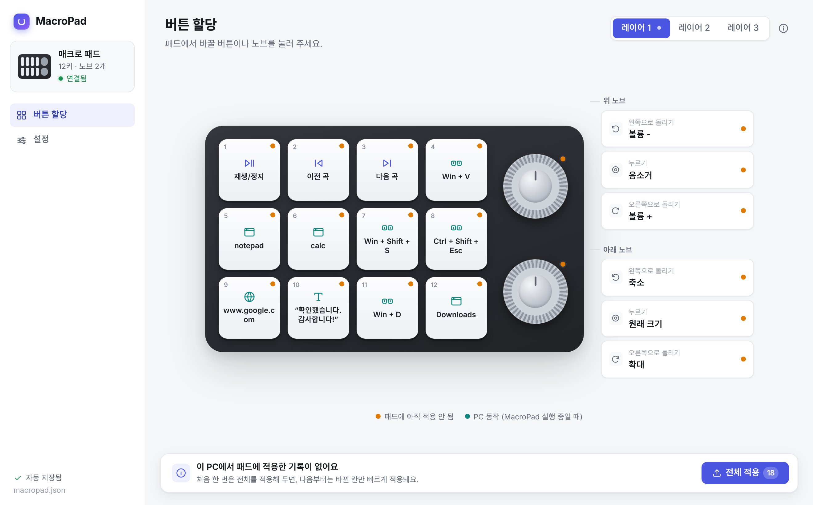
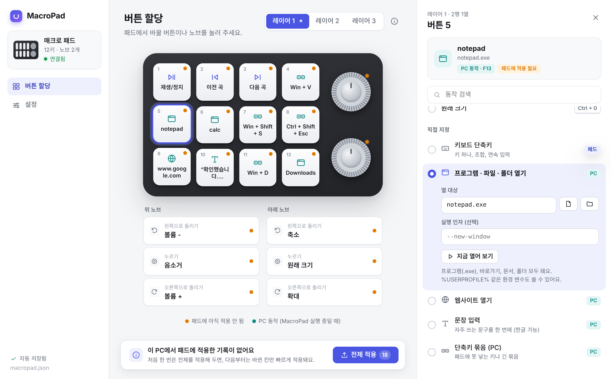
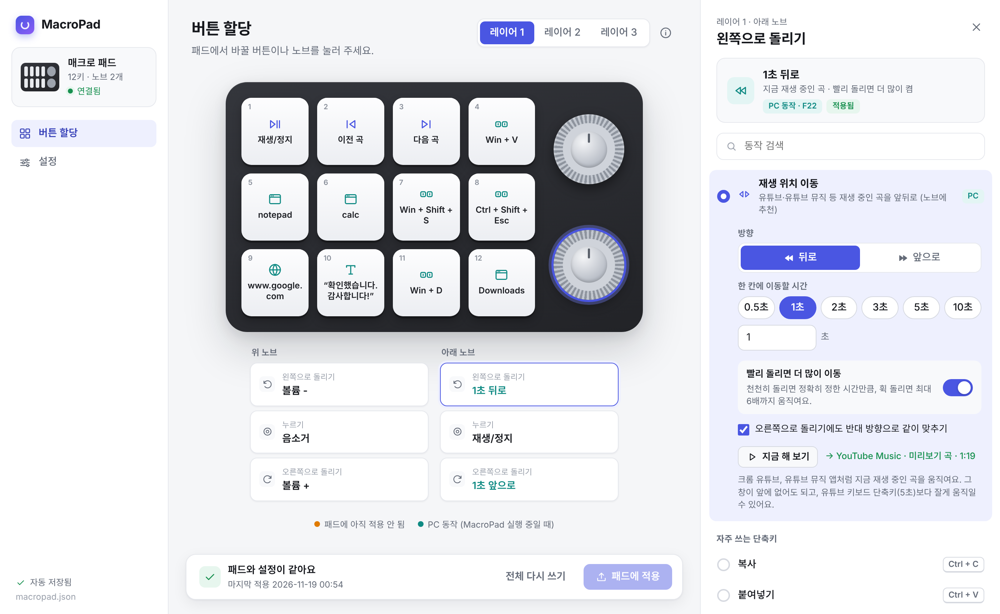
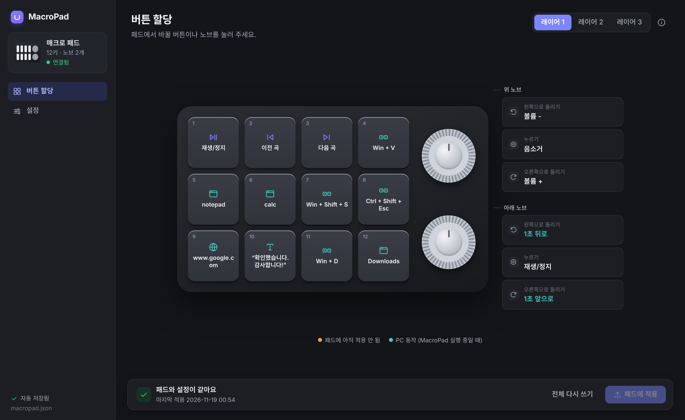

# MacroPad

알리익스프레스 등에서 파는 **12키 + 노브 2개 매크로 패드**(USB VID `514C` / PID `8850`)의 키를
판매자 프로그램 없이 자유롭게 바꾸는 Windows 앱입니다.

[](https://github.com/BangJeongHyeok/ali-pad-mapper/actions/workflows/ci.yml)


[](LICENSE)



> **English:** A Windows key-mapping app for the generic 12-key + 2-knob USB macro pad (VID 0x514C / PID 0x8850),
> without the vendor's tool. Click a key, pick an action, press *Apply*. Media keys and shortcuts are stored on the pad
> itself; PC actions (launch apps, type text, seek the playing song with a knob) run through a small tray app.
> The UI is Korean for now.

> 비공식 도구입니다. 제조사·판매자와 관계없으며, 패드 메모리에 직접 설정을 쓰므로 사용에 따른 책임은 사용자에게 있습니다.
> 잘못 썼을 때는 [공장 초기값으로 되돌릴 수 있습니다](#원래대로-되돌리기).

---

## 목차

- [주요 기능](#주요-기능)
- [스크린샷](#스크린샷)
- [준비물](#준비물)
- [설치와 실행](#설치와-실행)
- [사용법: 키 바꾸고 패드에 적용하기](#사용법-키-바꾸고-패드에-적용하기)
- [동작 원리](#동작-원리)
- [안 될 때](#안-될-때)
- [설정 파일 (macropad.json)](#설정-파일-macropadjson)
- [명령줄 도구 (PadFlasher)](#명령줄-도구-padflasher)
- [개발](#개발)
- [참고 / 출처](#참고--출처)

---

## 주요 기능

**편집기**
- 패드 그림에서 버튼이나 노브(왼쪽으로 돌리기 / 누르기 / 오른쪽으로 돌리기)를 눌러 동작을 고릅니다
- 고르는 즉시 자동 저장, 동작 검색, 라이트/다크 모드(Windows 설정을 따름)
- 키 조합은 직접 눌러서 입력합니다. 한글 입력 상태여도 물리 키 그대로 인식합니다
- 패드 연결 상태를 실시간으로 보여 줍니다
- **키 테스트**: 패드 버튼을 누르면 어느 칸인지, 언제 눌리고 떼졌는지(ms), 샘플 큐면 저장/이동 중 무엇으로 처리되는지 보여 줍니다

**패드에 저장되는 동작** (한 번 적용하면 PC 앱 없이, 다른 PC에 꽂아도 동작)
- 미디어: 볼륨 +/-, 음소거, 재생/일시정지, 다음/이전 곡, 정지, 화면 밝기
- 단축키: 복사·붙여넣기·화면 캡처 등 자주 쓰는 20개를 바로 고르거나, 아무 조합이나 직접 입력
- 연속 입력: `Ctrl+A` → `Ctrl+C` 처럼 여러 키를 차례로 (최대 18개)

**PC 동작** (MacroPad 트레이 앱이 켜져 있을 때)
- 프로그램 · 파일 · 폴더 열기 (바로가기, 환경 변수 `%USERPROFILE%` 등 지원)
- 웹사이트 열기
- 문장 입력 (한글 포함, 한/영 상태와 상관없이 그대로 입력)
- 긴 단축키 묶음 (개수 제한 없음, 단계 사이 지연 시간 지정)
- **재생 위치 이동**: 노브를 돌리면 유튜브·유튜브 뮤직 등 지금 재생 중인 곡을 턴테이블처럼 앞뒤로 감습니다
  - 한 칸에 0.5초·1초처럼 원하는 만큼 (유튜브 키보드 단축키는 5초 단위)
  - 그 창이 앞에 없어도 동작하고, 빨리 돌리면 최대 6배까지 크게 움직입니다
- **샘플 큐**: 샘플러처럼 버튼마다 곡의 위치를 저장해 두고, 누르면 그 위치로 바로 이동합니다
  - 큐 지정 키(펑션)를 누른 채로 큐 버튼을 누르면 지금 위치를 저장, 큐 버튼만 누르면 이동

**적용과 관리**
- **바뀐 칸만 패드에 적용**하고, 아직 적용하지 않은 칸은 주황 점으로 표시합니다
- 레이어 3개까지 편집, 공장 초기값 복원
- Windows 시작 시 자동 실행 (관리자 권한 불필요)
- 드라이버 설치 없음 (Windows 기본 HID 사용), 인터넷 연결을 쓰지 않음
- 설정은 `macropad.json` 파일 하나. 직접 편집해도 되고, 명령줄 도구로도 쓸 수 있습니다

## 스크린샷

| 버튼에 프로그램 열기 | 노브로 재생 위치 이동 |
|---|---|
|  |  |

<details>
<summary>다크 모드</summary>



</details>

---

## 준비물

| 항목 | 내용 |
|---|---|
| 패드 | USB VID `514C` / PID `8850`, 버튼 12개 + 노브 2개 모델 |
| OS | Windows 10 (1809 이상) 또는 Windows 11, 64비트 |
| 빌드 | [.NET 10 SDK](https://dotnet.microsoft.com/download/dotnet/10.0) (또는 Visual Studio 2026 ".NET 데스크톱 개발") |
| 실행 | .NET 10 **Desktop** Runtime — SDK를 설치했다면 이미 있습니다. `-SelfContained` 로 만들면 필요 없습니다 |
| 화면 | Microsoft Edge WebView2 Runtime — Windows 11은 기본 포함, Windows 10도 대부분 설치되어 있습니다 |

> 내 패드가 맞는지: 장치 관리자 → 휴먼 인터페이스 장치 → 속성 → 자세히 → 하드웨어 ID 에 `VID_514C&PID_8850` 이 보이면 됩니다.

---

## 설치와 실행

아직 미리 만든 설치 파일이 없으므로 소스에서 실행 파일을 만듭니다. PowerShell 에서:

```powershell
git clone https://github.com/BangJeongHyeok/ali-pad-mapper.git
cd ali-pad-mapper
.\tools\publish.ps1
```

`publish` 폴더에 실행 파일이 생깁니다.

| 파일 | 설명 |
|---|---|
| `PadAgent.exe` | **MacroPad 앱** (편집기 + 트레이). 이 파일을 실행하면 됩니다 |
| `PadFlasher.exe` | 명령줄 도구 (선택) |
| `macropad.example.json` | 설정 예시. 처음 실행할 때 `macropad.json` 으로 복사됩니다 |

- .NET 런타임이 없는 PC에서 쓰려면 `.\tools\publish.ps1 -SelfContained` (파일이 커지는 대신 설치 없이 실행)
- 빌드 없이 바로 띄워 보려면 `dotnet run --project src/PadAgent`
- GitHub Actions 가 커밋마다 같은 방식으로 빌드한 결과(`MacroPad-win-x64`)를
  [Actions](https://github.com/BangJeongHyeok/ali-pad-mapper/actions/workflows/ci.yml) 실행 결과에 올려 둡니다 (GitHub 로그인 필요)

### 처음 실행

1. 패드를 USB로 연결하고 `publish\PadAgent.exe` 실행 → 편집기 창이 열리고, 작업 표시줄 오른쪽 알림 영역에 아이콘이 생깁니다
2. 왼쪽 위 장치 카드에 **연결됨** 이 보이면 준비 끝
3. 편집기 **설정** → **Windows 시작 시 실행** 을 켜 두면 로그인할 때마다 트레이에서 조용히 실행됩니다 (편집기 창은 뜨지 않음)

편집기 창을 닫아도 앱은 트레이에 남아서 PC 동작을 처리합니다. 다시 열려면 트레이 아이콘을 더블클릭하거나
`PadAgent.exe` 를 한 번 더 실행하면 됩니다. 완전히 끄려면 트레이 아이콘 우클릭 → **종료**.

### 새 버전으로 바꾸기

실행 중인 exe 는 덮어쓸 수 없으므로 **트레이에서 먼저 종료**한 뒤에:

```powershell
git pull
.\tools\publish.ps1
```

설정 파일, 자동 실행 등록, 패드에 쓴 기록은 그대로 유지됩니다.

---

## 사용법: 키 바꾸고 패드에 적용하기

1. **칸 고르기** — 가운데 패드 그림에서 버튼을 누르거나, 오른쪽 노브 카드(왼쪽으로 돌리기 / 누르기 / 오른쪽으로 돌리기)를 누릅니다
2. **동작 고르기** — 오른쪽 목록에서 원하는 동작을 누릅니다. 고르는 즉시 저장됩니다

   | 목록 | 내용 | 동작하는 곳 |
   |---|---|---|
   | 할당 안 함 | 패드에 쓸 때 이 칸은 건드리지 않음 | – |
   | 미디어 | 볼륨, 음소거, 재생/일시정지, 다음/이전 곡, 밝기 | **패드** |
   | 미디어 › 재생 위치 이동 | 재생 중인 곡을 앞뒤로 (노브 추천) | PC |
   | 미디어 › 샘플 큐 / 큐 지정 키 (펑션) | 저장해 둔 위치로 순간 이동 (샘플러처럼) | PC |
   | 자주 쓰는 단축키 | 복사, 붙여넣기, 화면 캡처, 작업 관리자 등 | **패드** |
   | 직접 지정 › 키보드 단축키 | 입력 칸을 누르고 키 조합을 직접 누름. 여러 번 누르면 연속 입력 | **패드** |
   | 직접 지정 › 프로그램 · 파일 · 폴더 열기 | 파일/폴더 고르기 버튼, 실행 인자, **[지금 열어 보기]** | PC |
   | 직접 지정 › 웹사이트 열기 | 기본 브라우저로 열기 | PC |
   | 직접 지정 › 문장 입력 | 자주 쓰는 문구 (한글, 줄바꿈 가능) | PC |
   | 직접 지정 › 단축키 묶음 (PC) | 패드에 못 넣는 키나 긴 묶음 | PC |

3. **패드에 적용** — 아래 막대의 **[패드에 적용]** 을 누릅니다. 바뀐 칸만 패드에 씁니다

- **패드** 동작은 패드 메모리에 저장되므로 MacroPad 가 꺼져 있어도, 다른 PC에 꽂아도 동작합니다.
- **PC** 동작은 MacroPad 앱이 켜져 있을 때 동작합니다. 저장하는 순간 바로 반영됩니다.
  (패드에는 F13~F24 같은 신호 키가 대신 들어가고, 앱이 그 키를 받아서 실행합니다. 신호 키는 자동으로 정해집니다)
- 주황 점은 패드에 아직 적용하지 않은 칸입니다. 이 PC에서 처음 쓸 때는 **[전체 적용]** 으로 한 번 전부 써 두는 것을 권장합니다.
- 버튼에 마우스를 올리면 지금 들어 있는 동작이 보이고, 오른쪽 위 카드에 PC 동작인지, 적용되었는지가 표시됩니다.

### 재생 위치 이동 (노브 추천)

1. 노브의 **왼쪽으로 돌리기** 를 고르고 **미디어 › 재생 위치 이동** 을 누릅니다 → `1초 뒤로` 가 바로 들어갑니다
2. 오른쪽 돌리기가 비어 있으면 `1초 앞으로` 가 같이 들어갑니다 (다른 동작이 있으면 체크했을 때만 바꿉니다)
3. 한 칸에 움직일 시간(0.5 · 1 · 2 · 3 · 5 · 10초 또는 직접 입력)과 가속 여부를 정합니다
4. 노래를 틀어 둔 채 **[지금 해 보기]** 로 바로 확인 → **[패드에 적용]**

Windows 미디어 제어(볼륨 키를 누르면 뜨는 미디어 팝업과 같은 기능)로 동작하므로, 그 팝업에 나오는 앱이면 됩니다.
크롬의 유튜브 뮤직 앱에서 확인했습니다. 앱이 위치 이동을 지원하지 않으면 알림으로 알려 줍니다.

### 샘플 큐 (샘플러처럼 구간 이동)

1. 버튼 하나를 고르고 **미디어 › 큐 지정 키 (펑션)** 을 누릅니다
2. **[빈 버튼 N개를 샘플 큐로 채우기]** 를 누르거나, 원하는 버튼마다 **미디어 › 샘플 큐** 를 고릅니다 (번호는 자동으로 1, 2, 3 …)
3. **[패드에 적용]**

| 누르는 법 | 동작 |
|---|---|
| 큐 지정 키를 **누른 채로** 큐 버튼 | 그 버튼에 지금 재생 위치를 저장 (이미 있으면 바꿈) |
| 큐 버튼만 | 저장한 위치로 바로 이동. 아직 비어 있으면 지금 위치를 저장 |
| 큐 지정 키를 **짧게 톡** → 3초 안에 큐 버튼 | 그 한 번만 저장 (한 번 더 톡 하면 취소) |

- 저장한 위치는 MacroPad 앱을 끄거나 트레이 메뉴 **샘플 큐 모두 지우기** 를 누를 때까지 메모리에만 남습니다
- 곡이 바뀌어도 지우지 않으므로 다른 곡에서는 같은 시각으로 이동합니다 (곡보다 길면 곡 끝 1초 전)
- 큐 지정 키로 저장하면 알림으로 `큐 3에 저장했어.` 가 뜹니다 (큐 버튼만 눌러서 이동하거나 빈 큐에 저장될 때는 알림 없음). 재생 위치 이동과 같은 Windows 미디어 제어를 쓰므로 지원하는 앱도 같습니다
- 큐 지정 키에는 패드가 누르고 있을 수 있도록 F13~F24 중 하나가 단독으로 들어갑니다

### 원래대로 되돌리기

패드를 처음 상태(버튼 a~l, 노브 p~u)로 되돌리려면:

```powershell
.\publish\PadFlasher.exe upload configs\00-factory-default.json
```

---

## 동작 원리

패드는 **버튼에 기능을 새겨 넣을 수 있는 리모컨**이라고 보면 됩니다.

```
macropad.json
 ├─ layers  ── [패드에 적용] ──▶ 패드 메모리에 저장 ──▶ PC 앱 없이 동작 (미디어 키, 단축키)
 │
 └─ actions ── MacroPad 앱(트레이)이 실행 중일 때
                패드가 보낸 F13~F24 를 가로채서 ──▶ 프로그램 실행 / 문장 입력 / 단축키 묶음 / 재생 위치 이동
```

- 패드는 설정을 읽어 올 수 없습니다. 그래서 이 PC에서 마지막으로 쓴 내용을
  `%LOCALAPPDATA%\MacroPad\pad-514C-8850.json` 에 기록해 두고, 그것과 비교해서 바뀐 칸만 씁니다.
- 앱의 키보드 훅은 `actions` 에 있는 신호 키만 확인하고 삼킵니다. 다른 키 입력은 저장하거나 기록하지 않습니다.
  키 테스트 화면도 설정에 있는 키와 F13~F24 만 화면에 보여 주고 파일에 남기지 않습니다
  (보안 프로그램이 "전역 키보드 훅"을 경고할 때 참고하십시오).
- 로그는 `%LOCALAPPDATA%\MacroPad\agent.log` 에만 남습니다 (신호 키 이름과 오류만).

---

## 안 될 때

| 증상 | 해볼 것 |
|---|---|
| 장치 카드가 **연결 안 됨** | USB 다시 꽂기. 판매자 프로그램 등 패드를 잡고 있는 다른 프로그램 끄기. `PadFlasher list --all` 에 `514C` 가 보이는지 확인 |
| 편집기에 새 기능이 안 보임 | 예전 MacroPad 가 트레이에 떠 있으면 새 exe 를 실행해도 예전 창이 열립니다. 트레이에서 종료 후 다시 publish/실행 |
| **[패드에 적용]** 은 성공인데 노브가 글자를 찍음 | `macropad.json` 의 `advanced.reportIdMode` 를 `"zero"` → `"payload"` 로 바꿔서 **전체 다시 쓰기** |
| 글자는 안 찍히는데 볼륨이 안 변함 | `advanced.mediaModeByte` 를 `1` 로 바꿔서 전체 다시 쓰기 |
| 왼쪽/오른쪽이 반대 | 두 칸의 동작을 서로 바꾸기 |
| PC 동작이 안 됨 | 트레이에 MacroPad 가 떠 있는지 확인. 편집기 설정 → 로그 열기 |
| 특정 창에서만 단축키·문장 입력이 안 됨 | 관리자 권한으로 실행된 창에는 일반 앱이 키 입력을 보낼 수 없습니다 (Windows 보안 정책). `Win+L` 같은 보안 키도 불가 |
| 버튼이 가끔 안 먹음 / 큐가 잘 저장 안 됨 | 편집기 **키 테스트** 에서 눌러 보고 누름·뗌 기록을 확인. 큐 지정 키가 큐 키보다 먼저 떼진다는 경고가 뜨면 패드가 두 키를 같이 보내지 못하는 경우입니다 (짧게 톡 → 큐 키 방식을 쓰기) |
| 재생 위치 이동이 안 됨 | 그 앱이 볼륨 키 미디어 팝업에 나오는지 확인. 나와도 위치 이동을 지원하지 않는 앱이 있습니다 |
| 편집기 대신 회색 기본 창이 열림 | WebView2 Runtime 이 없는 PC입니다. [설치](https://developer.microsoft.com/microsoft-edge/webview2/)하면 새 편집기가 열립니다 |

---

## 설정 파일 (macropad.json)

편집기가 알아서 관리하지만 직접 고쳐도 됩니다 (주석 `//` 가능). 앱은 저장을 감지해서 바로 다시 읽습니다.

**어느 파일을 쓰나**: `--config <경로>` 로 지정 → 실행 파일 위쪽 폴더에 `MacroPad.sln` 이 있으면 그 옆
→ 실행 파일 옆. 그래서 레포 안의 `publish` 폴더에서 실행하면 레포 폴더의 `macropad.json` 하나를 계속 씁니다.

`macropad.json` 은 버튼 배치·프로그램 경로·문구가 들어가는 **개인 설정이라 git 에 올리지 않습니다** (`.gitignore`).
레포에는 예시 `macropad.example.json` 만 있고, `macropad.json` 이 없으면 처음 실행할 때 예시를 복사해서 만듭니다.
편집기로 처음 저장하면 주석이 사라지고, 원래 파일은 `macropad.json.bak` 으로 백업됩니다.

### 패드 칸 (`layers`)

```jsonc
"layers": [
  {
    "buttons": [                     // 왼쪽 위부터 가로로 12개
      "play", "prev", "next", "f21",
      "f13",  "f14",  "f15",  "f16",
      "f17",  "f18",  "f19",  "f20"
    ],
    "knobs": [                       // [위 노브, 아래 노브]. ccw = 왼쪽, press = 누르기, cw = 오른쪽
      { "ccw": "volumedown", "press": "mute", "cw": "volumeup" },
      { "ccw": "f22", "press": "play", "cw": "f23" }
    ]
  }
]
```

| 쓰는 법 | 예 |
|---|---|
| 미디어 키 | `"volumeup"`, `"volumedown"`, `"mute"`, `"play"`, `"next"`, `"prev"`, `"stop"`, `"brightnessup"` |
| 키 하나 | `"a"`, `"f5"`, `"enter"`, `"f13"` |
| 단축키 | `"ctrl+c"`, `"ctrl+shift+esc"`, `"win+shift+s"` |
| 연속 입력 | `"ctrl+a, ctrl+c"` (쉼표로 구분, 수식 키 포함 최대 18개) |
| 그대로 두기 | `null` 또는 `""` |

- 미디어 키는 단독으로만 (`ctrl+volumeup` 불가). `+` 키는 `numpadplus` 또는 `shift+equal`
- 전체 키 이름: `PadFlasher keys`
- 레이어는 최대 3개

### PC 동작 (`actions`)

```jsonc
"actions": {
  "f13": { "run": "notepad.exe" },                                   // 프로그램
  "f14": { "run": "C:\\Tools\\app.exe", "args": "--foo", "workingDir": "C:\\Tools" },
  "f15": { "run": "https://www.google.com" },                        // 웹사이트
  "f16": { "run": "%USERPROFILE%\\Downloads" },                      // 폴더
  "f17": { "keys": ["ctrl+c", "alt+tab", "ctrl+v"], "delayMs": 60 }, // 단축키 묶음
  "f18": { "text": "확인했습니다!" },                                 // 문장 (한글 가능)
  "f22": { "seek": -1 },                                             // 재생 위치 1초 뒤로
  "f23": { "seek": 0.5, "seekAccel": false },                        // 0.5초 앞으로, 가속 없음
  "f24": { "cueSet": true },                                         // 큐 지정 키 (누른 채로 큐 키 = 지금 위치 저장)
  "shift+f13": { "cue": 1 }                                          // 샘플 큐 1번 (누르면 저장한 위치로 이동)
}
```

- 신호 키는 일반 키보드에 없는 **F13~F24** 를 권장합니다 (모자라면 편집기가 `shift+f13` 등을 씀)
- 경로의 `\` 는 JSON 이라 `\\` 로 두 번

### 고급 (`advanced`)

첫 연결이 잘 안 될 때만 바꿉니다. `reportIdMode`, `mediaModeByte`, `knobSlotBase`(이 모델은 16),
`keyDelay`, `packetIntervalMs` 등. [안 될 때](#안-될-때) 참고.

---

## 명령줄 도구 (PadFlasher)

편집기 없이 설정 파일 그대로 패드에 쓰거나, 통신을 확인할 때 씁니다.
`publish\PadFlasher.exe <명령>` 또는 `dotnet run --project src/PadFlasher -- <명령>`.

| 명령 | 설명 |
|---|---|
| `list` (`--all`) | 패드 찾기. `★ 설정 통로` 줄이 보이면 정상 |
| `info` | 패드에 키/노브 개수 묻기 (응답 `03 FB 0C 02 …` = 키 12, 노브 2) |
| `upload [파일] --dry-run` | 보낼 패킷 미리보기 (실제로 안 보냄) |
| `upload [파일]` | 패드에 쓰기. `--changed` = 바뀐 칸만, `--yes` = 확인 생략 |
| `keys` | 쓸 수 있는 키 이름 목록 |
| `raw 03 FB FB FB` | 패킷 하나 직접 보내기 (실험용) |

---

## 개발

```powershell
dotnet build                 # 빌드
dotnet test                  # 테스트 (패드 없이 실행. 패킷 바이트, 설정, 편집 모델, 화면 메시지)
dotnet run --project src/PadAgent
```

Visual Studio 에서는 `MacroPad.sln` 을 열고 시작 프로젝트를 `PadAgent` 로 지정합니다.
Core 와 테스트는 OS 무관이라 Linux/macOS 에서도 빌드·테스트됩니다 (`EnableWindowsTargeting`).

### 편집기 화면 고치기

화면은 `ui/` 의 HTML/CSS/JS(프레임워크·CDN 없음)이고, 빌드할 때 exe 안에 포함됩니다.
패드나 Windows 없이 브라우저에서 바로 볼 수 있습니다:

```powershell
dotnet run --project tools/UiPreview    # → http://localhost:5180
```

임시 복사본 설정과 가짜 패드를 써서 실제 `macropad.json` 은 건드리지 않습니다. `ui/` 를 고치고 새로 고치면 바로 반영됩니다.

### 프로젝트 구조

| 경로 | 역할 |
|---|---|
| `src/MacroPad.Core` | 설정 파일, 키 이름 표, 패드 프로토콜(패킷 생성), HID 통신, 편집 모델, 화면 메시지 처리 |
| `src/PadAgent` | 트레이 앱 + 편집기 창(WebView2), 키보드 훅, PC 동작 실행 |
| `src/PadFlasher` | 명령줄 도구 |
| `ui` | 편집기 화면 |
| `tools/UiPreview` | 화면 미리보기 서버 |
| `tests/MacroPad.Tests` | xUnit 테스트 |

| 바꾸고 싶은 것 | 파일 |
|---|---|
| 키 이름 / 미디어 키 | `src/MacroPad.Core/Keys/KeyTable.cs` |
| 패킷 형식 | `src/MacroPad.Core/Protocol/K8850Protocol.cs` |
| 설정 파일 항목 | `src/MacroPad.Core/Config/PadConfig.cs`, `ConfigWriter.cs` |
| HID 장치 찾기 / 전송 | `src/MacroPad.Core/Hid/HidDevices.cs` |
| 칸 편집 규칙 (신호 키 자동 배정 등) | `src/MacroPad.Core/Editing/ConfigEditor.cs` |
| 화면 ↔ C# 요청 처리 | `src/MacroPad.Core/Editing/EditorSession.cs` |
| 편집기 화면 | `ui/index.html`, `ui/app.css`, `ui/app.js` |
| 편집기 창 (WebView2) | `src/PadAgent/Editor/WebEditorForm.cs`, `WindowsEditorPlatform.cs` |
| PC 동작 종류 추가 | `src/PadAgent/ActionRunner.cs`, `TriggerMap.cs` |
| 재생 위치 이동 | `src/MacroPad.Core/Media/SeekTracker.cs`, `src/PadAgent/Media/MediaSeeker.cs` |
| 샘플 큐 (저장/이동 판단) | `src/MacroPad.Core/Media/CueBank.cs`, `src/PadAgent/ActionRunner.cs` |
| 트레이 메뉴 | `src/PadAgent/TrayApp.cs` |
| 바뀐 칸만 쓰기 | `src/MacroPad.Core/Protocol/PadState.cs`, `UploadPlan.cs` |

더 자세한 설계 메모와 결정 이유는 [docs/HANDOFF.md](docs/HANDOFF.md) 에 있습니다.

### 프로토콜 요약

```
패킷 64바이트 (Windows 에서는 리포트 ID 1바이트를 붙여 65바이트 HID 출력 리포트, 인터페이스 MI_00)

바인딩:  03 FD <슬롯> <레이어 1~3> <종류> 00 <내용…>
           슬롯: 버튼 1~12 / 위 노브 16·17·18 / 아래 노브 19·20·21 (왼쪽·누름·오른쪽)
           종류 1 키보드: 키 하나 → 01 00 00 <HID코드> 00
                          그 외   → <개수> 00 00 + 항목마다 [<코드> 00 <지연>]
                                    (수식 키: Ctrl F1, Shift F2, Alt F3, Win F4)
           종류 2 미디어: 02 00 00 <Consumer 코드>
확정:    03 FD FE FF   (바인딩마다 뒤에 하나씩)
질의:    03 FB FB FB   → 응답 03 FB <키 개수> <노브 개수> …
```

---

## 참고 / 출처

- 프로토콜 분석: [kriomant/ch57x-keyboard-tool](https://github.com/kriomant/ch57x-keyboard-tool) (MIT)
  - 이슈 #89 "Supporting 0x514c : 0x8850" — 12키 + 노브 2 모델의 슬롯 번호, 미디어 코드, Windows HID 방식
  - PR #154 / #174 — `FD` 바인딩 형식
- 이 프로젝트 코드는 위 공개 분석 내용을 바탕으로 C# 으로 새로 작성했습니다.

## 라이선스

[MIT](LICENSE)
